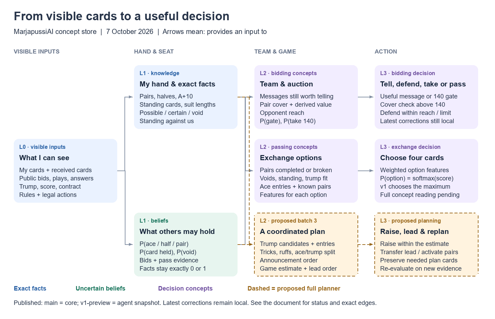

# Architecture

Updated 2026-10-08 from the concept catalogue and the checked-out workspaces.
Each crate owns one kind of information and exposes it through its `lib.rs`
façade. Dependencies point toward the rules and the seat's visible information.

| Layer | Owner | Role | Availability |
|---|---|---|---|
| Rules | `engine` | Legal actions, ranks, pair values, scoring and fast bitset play | Published on `main`. |
| Visible information | `observation` | Own hand, public events and private exchanges visible to that seat | Published on `main`. |
| Exact knowledge | `knowledge` | Possible/certain holdings, voids, standing cards, pairs and sound deductions | Core on `main`; extra hand features in preview/local work. |
| Uncertain information | `beliefs` | Fact-constrained card/seat distributions and convention readings | Continuing `v1-preview`; pass-choice interpretation remains planned. |
| Decisions | `agent`, `heuristic`, `solver` | Agent interface, concept-based strategy and exact endgame search | Continuing `v1-preview`, including bidding/pass corrections and safe history reuse. |
| Evaluation | `eval`, `tools` | Duplicate-deal comparisons, recorded-game checks and decision explanations | Published snapshot on `v1-preview`; additional studies local. |
| Coordinated planning | Proposed concepts within the decision layer | Entries, trump activation, game estimate, raising and replanning | Batch-3 proposal; no complete implemented planner. |
| Learned policy | Future policy work | Self-play learning above facts and beliefs | Future work. |

The development/debugging UI is a separate application built against a sibling
AI checkout; it is not part of this crate workspace.

## Concept dependencies

The [concept-store document](design/concept-store.md) provides the current graph,
its calculations, proposal/implementation labels and revision references.

Historical 7 October design graphic; the table above gives current publication status.

The catalogue is a design source implemented through typed Rust helpers. It
does not imply a generic runtime graph store. Rules remain in `engine`, exact
deductions in `knowledge`, uncertain readings in `beliefs`, and the combination
of those concepts into actions in `heuristic`.

## Invariants

1. **Seat-limited input:** decisions use only that seat's visible information.
   Other players' actual hidden hands are reserved for simulation and evaluation,
   never agent evidence. Consistent hidden-hand swaps check this boundary.
2. **Facts stay exact:** conventions adjust uncertain beliefs, but cannot
   contradict certain holdings or truthful public answers.
3. **One owner per rule:** legality and scoring come from `engine`; other crates
   call that owner rather than copying game rules.
4. **Understandable decisions:** named concepts carry inputs and reasons.
   Choice-model coefficients are labelled empirical rather than game-rule facts;
   proposals are distinguished from implemented, approved behaviour.
5. **Bounded work:** incremental updates and lazy queries should reuse unchanged
   information. Performance changes require measurements and correctness checks;
   the diagram is not evidence that every proposed cache exists.

## Next design work

Complete and review concept-level pass reading, connect exchange choices to a
coordinated plan, and evaluate decisions with the owner. Whole-game search and
learned policies follow later; the exact endgame solver is a separate bounded
tool. See the concept-store status table before treating a design as shipped.
