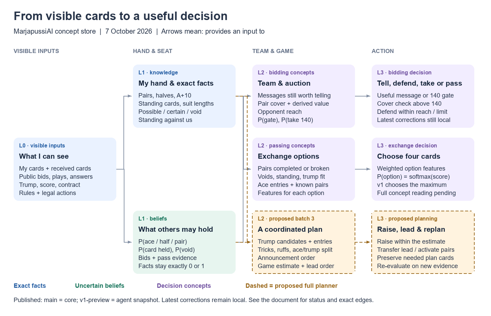

# Concept store: from cards to decisions

Updated: 2026-10-08. This document describes the concept catalogue and its dependencies, including proposed work. It is a design graph, not an automatically extracted Rust call graph.

Local continuation, 2026-10-09: [entry conditions](entry-conditions.md) and
[bounded return forecasts](return-rollouts.md) now consume this catalogue through
typed Rust helpers and the shared seat-view table. The latter document gives the
implemented dependency loop. Whole-game optimal search, calibrated score
probabilities and raising remain outside this v1 slice; older diagrams below
retain their historical status.

The graphics and machine-readable graph below preserve the **7 October design snapshot**. Their "corrections remain local" labels are historical; the current publication status is in the table below.



[Full-size graphic](../assets/concept-store.svg) · [Machine-readable graph](../assets/concept-store.json)

Read arrows as **“provides an input to”**. L0 contains visible information and exact deductions; L1 describes hands and seats; L2 combines them into team and game concepts; L3 chooses an action. The graphic groups related concepts. The tables below spell out their individual dependencies.

## What is available where

| Version | Available work |
|---|---|
| `main` | Published rules engine, seat observations and exact knowledge. The other layers below describe the wider design, not crates present on this branch. |
| `v1-preview` | Continuing heuristic agent, beliefs, solver and evaluation tools, including the `kb/batch1` corrections, condensed C42 pass model and history-cache fix. See [checkpoints](../checkpoints/2026-10-08-publication.md). Additional `feat/study-full` evaluation experiments remain local. |
| Proposed game plan | Batch 3: entries, announcement order, coordinated trump and ace splits, estimated secured points, raises and replanning. These dependencies are proposals; the full planner is not implemented. |

The source is the working catalogue `findings/kb/concepts.md`, with passing clarifications in `findings/kb/03-passing.md`. Both live in the separate local research workspace. This repository carries a portable summary without recorded games, player identities or private workspace links. Later dated corrections in the catalogue supersede earlier drafts. Implementation status was checked against the local Rust source at the revisions above; this documentation update changes no agent behaviour.

## L0 → L1: what a seat can know or believe

An agent starts with its own hand, public events and the cards privately passed to or received by that seat. Other seats' actual hands are never an input. Legality, rank order, card points, pair values and scoring belong to `engine`.

| Concept | Inputs / calculation | Kind and owner |
|---|---|---|
| `possible(y)`, `certain(y)`, `void(y,s)`, `count_bounds(y,s)` | Own visible cards, public plays, truthful answers and observed exchanges constrain possible holdings. | Exact deductions; `knowledge`. |
| `my_pairs`, `my_halves`, `my_aces`, `ace_ten(s)` | Own cards; a pair is King + Ober of a suit, a half is an unmatched King or Ober, `ace_ten` holds both A and Z. | Exact hand features; rules and `knowledge`. |
| `own_standing`, `standing_known(seat)` | Top-down rank runs; own-hand standing and standing supported by known facts are distinct views. | Exact within the relevant view; `knowledge`. |
| `standing_against_us` | Treat all cards outside my hand as opponents' cards; run each suit from the top while my lowest cards fall, and count the remaining opponents' cards when I run out. | Conservative hand count, 0–27; `knowledge`. It is not a probability or the opponents' actual hand. |
| `has_ace(y)`, `has_halves(y,k)`, `has_pair(y,s)` | Facts + auction history + the shared bid encoder read in context; feature-distribution calculations give seat probabilities. | Uncertain seat features; `beliefs::Mind`. |
| `p_holds(y,c)`, `p_void(y,s)` | Fact-constrained card distribution, updated by available bid and exchange evidence. | Beliefs; exact facts force probabilities to 0 or 1. |
| `bluffing(y)` | A signal has zero support under the facts; the catalogue calls for reduced trust in that seat's signals. | Belief-reading concept; it does not weaken exact facts. |
| `seat_style(y)` | How a seat's convention is interpreted. The catalogue's v1 default is our convention for everyone. | Individual style exceptions remain proposed. |

## L1 → L2 → L3: bidding

| Concept | Direct inputs | Used by / current meaning |
|---|---|---|
| `info_to_tell` | Own aces, halves and pairs; previous messages; auction context; what the partner already knows | B-tell sends useful remaining messages. Latest local order: red, bells and acorns pairs before the ace; with a green pair, ace first. |
| `info_channel_open`, `team_plan_formed`, `opponents_exchanging` | Auction values and messages, including a 140 gate | Decide whether to tell or gate; the auction record carries context between steps. |
| `partner_completes(h)` | `p_holds(partner, other_half(h))` | Completion probability for a split pair; also an input to passing. |
| `team_pair(s)` | Own pair/half facts + partner's believed halves/pairs | Team pair possibilities, not a claim about unseen cards. |
| `derived_pair_value` | Own single halves × probability the partner has their counterpart × suit pair value | Expected pair value, excluding green and own complete pairs. It feeds `game_drive`. |
| `team_pair_cover(V)` | Team pair possibilities + excess contract value above 140 | B-over140 checks whether a pair can cover the excess. The latest tie-break uses `team_pair_cover_derivable`: own complete pairs or pairs supported by partner messages, not own halves at base rates. |
| `opp_reach` | Opponents' pair evidence + pair values + 140 card/last-trick ceiling | Caps B-defend; stop protecting against a value the opponents cannot plausibly reach. |
| `game_drive` | Own standing, A+10 suits, own and derived pair values, prospective target, partner's calls and remaining message | Probability of preferring 140 to the information step. A logistic score combines the terms; local v1 acts at 0.5. It is not the final game estimate. |
| `standing_potential` | Intended: own top run + cards the partner may hold and pass | Catalogue target: probability that a suit becomes standing after exchange. **Current C43b implementation is a count proxy:** for A+Z-headed suits of length ≥4, sum `length − top_run_length`. |
| `p_take_140` | Own standing, A+10 suits, own pair value, derivable pair cover at 145, standing-potential proxy, value 135, partner state and aces | Probability of taking 140 rather than passing when nothing remains to tell. C43b distinguishes this from `game_drive`'s tell-vs-140 choice. |
| `hand_quality`, `team_reach`, `schwarz_chance_us`, `pass_quality` | Hand structure, partner signals, pair values and exchange prospects | Wider catalogue concepts. Some calculations are proposed; they are not a complete implemented planning system. |

The C43b local implementation calculates:

```text
p_take_140 = sigmoid(-4.85
  + 0.39 * own_standing + 0.10 * ace_ten_suits
  + 1.07 * own_uncalled_pair_value / 100
  + 3.21 * team_pair_cover_derivable(145)
  + 0.42 * standing_potential_count
  + 0.84 * [value == 135]
  - 0.48 * [partner passed] - 0.21 * [partner not yet acted]
  + 0.76 * own_aces)
```

These coefficients come from the recorded-human decision analysis described in the catalogue. They are empirical choice-model coefficients, not consequences of the game rules or evidence of stronger play. The source reports 1,261 decisions at 125–135; this update did not rerun that analysis.

The current local bidding path checks gate part 2, then B-tell with its cover and tie-break checks, then B-defend, gate part 1, and finally the nothing-left-to-tell take/pass choice. B-defend depends on a first-turn partner pass, opponent bidding, a near-hopeless hand, its limit table and `opp_reach`; it replaces the earlier B-block proposal. The implementation still requires no ace, no pair and fewer than three halves. The later catalogue exception for a lone green pair is an open implementation gap.

For messages landing on 140, +10/+15/**+20** shift to 145 and larger live messages shift with them; +5 neither shifts nor triggers a shift (latest C43c correction). The catalogue bands are ≥0.8 “believed yes”, ≤0.2 “believed no”, and otherwise open. Action thresholds such as 0.5 or the pair-cover check are separate policy decisions.

## Passing: compare the exchange options

Each legal four-card exchange gets a feature vector. Features depend on the seat's view and the hand left by that option, so they are recomputed for each option. `score(x) = Σ weight × feature(x)`; `P(x) = softmax(score(x))`. The local v1 default chooses the maximum; these choice probabilities are not win probabilities.

| Concept family | Direct inputs | What it contributes |
|---|---|---|
| Exact exchange structure | Hand and option `x`, suit/rank rules | Voids, whole side suits, points, green cards, blank/guarded tens, aces, standing after exchange and `pair_broken`. |
| Completing the partner | Passed halves + `partner_completes`; passed aces + P(partner lacks an ace) | Belief-weighted assistance rather than counting every half or ace equally. |
| Pair information | Whole pairs passed + what the partner knows from bids | Separates known and unknown pairs. Latest C42c clarification favours passing an unknown whole-suit pair to consolidate trump; the known case permits either choice. |
| Trump fit | `team_pair` + suit value → `likely_trump` / current pass-model `plan` | Cards of a candidate trump kept or passed, including top trump for the last trick. |
| Ace entry / `schnippeln_feasible(s,x)` | Ace sent back, a lower non-pair card kept, partner's likely suit holding and first-trick green restriction | Give the partner the ace and later lead low to it. For a non-green first lead, the passer must keep no green cards. The catalogue's full feasibility concept is richer than the current option features. |
| `pass_legibility(x)` | Option + bid context + partner's model of the pass + importance of the team pair | Intended probability the partner reads the suit holding or void correctly. Full concept-level legibility remains a design target. |

Current C42 feature names, in their code order:

```text
forth: lusche_from_kept_suit, pair_broken, blank_with_lusche,
       blank_without_lusche, points, tens_guarded, tens_blank, aces,
       aces_x_vh_lacks_ace, pairs_known, pairs_unknown,
       halves_x_completes, green

back:  standing_after, aces_entry_low_kept, pair_broken,
       lusche_from_kept_suit, voids_made, halves, side_suits_complete,
       aces, points, pairs, halves_x_completes, plan_top_trump_kept,
       plan_trump_given, aces_x_mh_holds_suit, green, tens
```

The catalogue's R1–R4 reading proposals infer likely voids from low-card groups, likely remaining suit cards from a ten/king without a low card, a whole suit in the return pass, and a mild low-card indicator. **Pass-choice interpretation is not implemented.** The older reader was unused and has been removed. Active beliefs account for exchange constraints without inferring why the giver chose those cards; see [passing models](../PASSING.md). A future reader must use the giver's possible view, never its hidden remaining hand.

## Proposed game plan: connect the exchange to later play

These edges are the catalogue's batch-3 proposal, represented by dashed boxes and arrows in the overview. They must not be read as a shipped planner. Some lower-level valuation and pass-model helpers already exist, but do not implement the complete chain.

| Concept | Direct dependencies | Intended result |
|---|---|---|
| `trump_candidates(s)` | `team_pair`, `partner_completes`, entries | Ways to activate trump: own announcement, partner announcement, pair question or half question. |
| `sure_tricks(seat)` | Standing cards, opponent `p_void`, current/candidate trump | Top-down tricks adjusted for opponent ruff risk; uncertain cases are estimates, despite the working name. |
| `entries` | `schnippeln_feasible`, standing/winning cards of both partners | Routes for handing the lead to the partner and receiving it back. |
| `schnippeln_gain(s)` | Feasibility, partner's tricks, opponent void/trump risk, trump candidates | Extra tricks and useful lead transfer compared with keeping the ace. |
| `ace_split` | Positive `schnippeln_gain`, ace-entry probability | Split aces only when the feasible low-lead line improves the plan. |
| `trump_plan_legible` | Bids, cards sent back, `partner_completes`, pass legibility and partner reading | Probability the partner understands which cards to keep and when to ask or announce. |
| `trump_split` | Candidate pairs, voids created, `trump_plan_legible` | Give one pair/suit to the partner and keep another to enable ruffing. |
| `ruff_line(s)` | Split/void structure, current trump, opponent card beliefs | One partner leads a suit the other can trump. |
| `activation_order` | Trump candidates, lead access, trick prospects, opponent pair possibilities | Activate pairs in a useful order. Latest proposal: the given pair first, retained stronger/longer trump last. |
| `game_estimate` | Activatable pairs, trick points, ruff lines, entries and last-trick control | Points the plan can secure, rounded down to a multiple of five; not a whole-game exact search. |
| `raise_message`, `raise` | `game_estimate`, own pairs and plan legibility | Raise within the estimate and communicate whether pair questions or a schwarz plan are needed. Red-pair 160 is unconfirmed. |
| `lead_sequence` | Tricks, entries, announcement order, opponent void/trump risk | Safe leads, lead transfers, pair activation and trump/ruff lines. |
| `replan` | New visible event, contradiction or increased failure risk | Recompute the next version of the plan. |
| `win_safety(card)`, `half_potential(card)` | Seats behind, card beliefs, pair completion/value and activation prospects | Prefer a safe ace when it wins without spending a half needed for an unannounced pair. Full connection to the proposed planner remains future work. |

The graph is evaluated for one information state at a time. `entries`, trump activation and trick prospects constrain one another; candidate plans need evaluation under an assumed trump/lead sequence rather than pretending every value can be computed independently. A new observation starts the next evaluation. Similarly, pass reading must use a model for the other seat's possible view, never its actual hidden hand.

## Ownership, updates and maintenance

`engine` owns rules; `observation` exposes the allowed view; `knowledge` owns exact deductions; `beliefs` owns uncertain seat/card features; `heuristic` combines them into decisions. The concept store is currently a Markdown design catalogue implemented through typed Rust helpers, not a generic graph database or a complete dependency scheduler. The separate research `kg` index searches code and documentation; it is not the runtime concept store.

Dependencies describe the intended invalidation boundary: a card play changes holdings and standing/void deductions; a bid changes auction context and beliefs; an exchange changes known cards and candidate hands; an announcement changes trump-related plan values. Reuse unaffected values where supported by the implementation. Lazy calculation and memoisation are design goals, not claims that every table entry already has an incremental cache.

When updating this document, check the latest catalogue corrections against code, retain proposal/implementation labels, and update the version table. Edit `docs/assets/concept-store.json` for the grouped overview and regenerate both images with `python docs/assets/render_concept_graph.py` (Python + Pillow). Keep recorded games and person-specific analysis outside the repository. The embedded PNG works without Mermaid or special Markdown rendering; the SVG remains zoomable.
