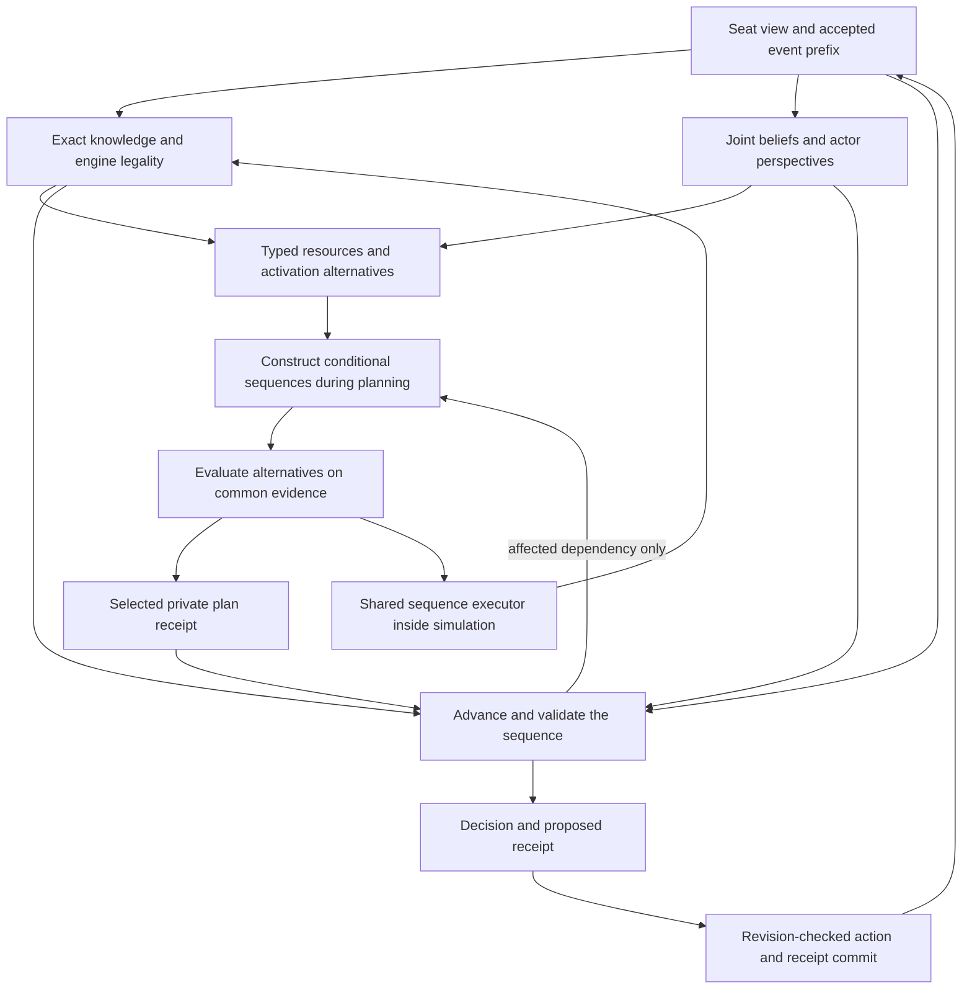
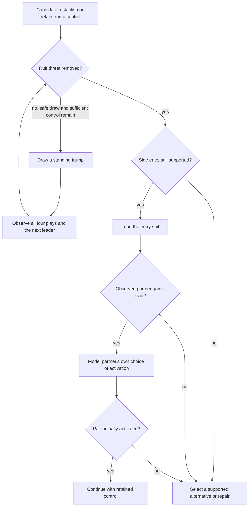

# Conditional sequences: planning that survives the next turn

Status: **design for implementation**, based on `1907407`. The policy described
here is not implemented or qualified. This is the next slice of the
[concept-store design](concept-store.md), using the existing crates and runtime.
The [targeted review](../checkpoints/2026-10-11-conditional-plan-dryrun.md)
provides the evidence; its preserved pairs and entries did not reliably become
completed activation routes.
Two [cloud research prompts](sequence-research-prompts.md) target adaptive
planning and efficient incremental computation without blocking the first slice.

The change is to select and execute a conditional sequence, rather than select
one action and leave its dependencies to later independent decisions. A sequence
can draw opposing trumps, retain a side entry, transfer the lead, activate a pair,
and recover control. Observations decide which steps still make sense. These are
composable game concepts, not scripts for particular hands.

Expensive comparisons belong in planning. Normal play advances the selected
sequence, checks its dependencies and uses prepared alternatives. Memoization
reuses calculations; a separate private receipt retains the selected intent.

## 1. What the evidence requires

| Finding | Design consequence |
|---|---|
| A winning trump draw was already a candidate, but was ranked below a losing side entry. | Adding another first action is insufficient. Compare the continuation actually intended after it. |
| Forcing a late pair question collected its points but still lost two reviewed contracts. | Evaluate activation feasibility during allocation and bidding, not only when the pair becomes urgent. |
| A pair can survive while its owner's lead, question right or return entry disappears. | Resources include cards, actor-specific rights and reachable lead opportunities. |
| A partner knows a card was passed but can still choose another move. | Separate a fact, knowledge available to that actor, and a prediction of its action. |
| The current forecast memo returns a decision without updating its actor. | Stateful policy reuse must reproduce the state transition as well as the action. |
| Followers were fast; some empty-trick leads spent over a second forecasting. | Classify work by operation, not the engine's broad `Trick` phase. Precompute continuations and remove repeated full-game lead searches. |

The saved sample contains 324 following decisions averaging 0.403 ms, with a
6.776 ms maximum; 142 lead/question/announcement decisions averaged 77.890 ms,
with a 1,341.549 ms maximum. These are measurements on that sample, not latency
guarantees. Planning may take a second or more. Ordinary in-play decisions must
not restart that planning workload.

## 2. Owners and execution flow

| Owner | Retained responsibility | Extension |
|---|---|---|
| `engine` | Legality, transitions, rights, trump, scoring | Remains the authority for every simulated and committed action. |
| `observation`, `agent::Table` | Seat-filtered events and views | Provide the same honest views during sequence evaluation and live execution. |
| `knowledge` | Certain deductions and own-hand claim proofs | Supply exact resource/guard proofs. Keep proof over all hard-consistent hands, including belief-model zero-weight hands. |
| `beliefs` | `ConceptQuery`, joint holding mass, `Perspective` | Expose resumable, bounded query work and its uncertainty; own probability/cache invalidation. |
| `solver` | Legal trick control and exposed-deal endgames | Supply capability checks and exact completed search results. |
| `heuristic::planning` | Candidate comparison and continuation forecasts | Own sequence construction, selection, execution and private receipts. |
| Testbed Rust service | AI jobs, sessions, revision checks | Store each seat's receipt with the accepted action; Python/PyO3 transport it privately through existing persistence. |
| `eval`, `tools` | Honest replay, paired comparisons, profiling | Record receipt provenance, plan transitions and dependency failures. |

The repair arrow uses an in-play work allowance. It does not authorize a new
multi-second forecast on every lead. Planning and execution are separate entry
points in the same module, with one executor.

## 3. A small domain model

Use concrete Rust enums and compact indexed storage inside `heuristic::planning`.
The existing concept store continues to describe holdings and epistemic queries.
Temporal actions do not belong in `beliefs::Concept`.

| Proposed type | Meaning |
|---|---|
| `Sequence` | Immutable, bounded program of game goals, guarded transitions and alternatives. A constructor verifies references, progress and capacity. |
| `Step` | One goal: develop a run, remove a ruff threat, transfer the lead, activate a pair, or cash/control the remaining play. Refers to concrete suits, seats and cards. |
| `Guard` | Exact observable condition, conditional belief query, or outcome of an already observed action. Carries its evidence kind. |
| `Resources` | Cards that must survive, required actor rights, lead/entry requirements, uncalled suits and minimum control needed after a step. |
| `PlanReceipt` | Versioned private semantic state: selected sequence, current step, reservations, pending proposed action, evidence anchor and policy identity. |
| `PlanEvaluation` | Outcome estimates/bounds, coverage, response-model assumptions, work and failed dependencies for one sequence. |
| `Advance` | `Action`, `AwaitObservation`, `Complete`, or `Repair` with a typed reason. An action is checked against engine legal actions. |

These are design names, not new public APIs already present in the code.
Start with these shapes; do not build a general-purpose graph interpreter.
Store only reachable alternatives, and deduplicate identical suffixes by full
structural equality. A loop such as drawing trumps must consume a card or accepted
event on every iteration. Questions cannot form a zero-progress cycle.

### Activation is a route, not possession

Reuse `trump_plan::Activation` alternatives:

- The pair owner obtains the lead and legally announces.
- Its partner obtains the lead and legally asks for the pair.
- A holder of a split pair obtains the lead and legally asks for the other half.

Each route checks who can initiate it, surviving halves, available rights,
uncalled suit, remaining cards, and entry timing. A respondent does not need the
initiator's lead or announcing right. Engine legality remains final.

A pair's score is counted only after its legal activation in the simulated
transition. Entry cards are consumed when played; the same Ace cannot pay for
two entries. Rights are actor-specific. One future lead is not credited to
several incompatible declarations. Mutually exclusive branches can reserve the
same resource, but a realised branch must have a consistent resource ledger.

### Example: remove a threat, then use the entry

The first step is not "always draw trump". Compare its lost trump resources and
tempo against immediate entry, cashing winners, own announcement and partner
question. A draw can be harmful if it consumes the partner's only useful trump.
Likewise, a side-suit entry by Ace and an entry by ruff are different routes.
After a return pass, a returned card makes that player non-void in its suit until
the card is played; an earlier void inference cannot survive unchanged.

The root never commands the partner's next move. That edge records an expectation
about the partner's own policy. The next observation can confirm or invalidate it.

### Execution protocol

1. Synchronize **all** new seat-visible events, including forced decisions and
   truthful answers; the current early-return paths must not skip plan updates.
2. Resolve the pending action only when it appears in accepted history. A proposed
   or rejected action consumes no card, right or step.
3. Advance completed steps, apply resource changes and inspect dirty guards.
4. Prefer an applicable exact claim/raising certificate through the existing proof
   path. Its priority and safety guarantees remain explicit.
5. Execute the supported step, or select a prepared alternate branch. Read a
   belief query only if an unresolved guard can affect that choice.
6. If no branch is supported, repair the affected suffix within the in-play
   allowance. If unfinished, use the existing legal fallback and record why.
   Record how that action changes or abandons the receipt.

A sequence is revisable intent, not a promise to continue a losing plan. New
evidence can invalidate its feasibility or change its value relative to an
alternative. Recheck affected comparisons even when the current move is legal.

### Adapt to improved opportunities as well as broken plans

Keep the remaining program, its feasibility, and its last value assessment as
separate state. Every assessment records the evidence/model revision on which
it depends. A new belief invalidates that assessment even when the cards and
rights needed by the sequence still exist. The receipt's old estimate is then
historical provenance, not the current estimate.
Use an `EvaluationStamp` containing fact/signal epochs, objective, response level,
remaining sequence and work/evaluation lane. A stale assessment may order work,
but cannot settle a choice. At every discretionary lead, a bounded structural
opportunity scan nominates newly supported routes; it does not select them by
rule or require a full search merely to discover them.

On each observed event, classify the required review:

| Change | Response |
|---|---|
| No dependency or value input changed | Advance the cursor; reuse supported results. |
| New evidence changes relative likelihoods | Dirty the affected assessments and compare the remaining plan and alternatives under the current posterior. |
| A new winner, pair route, void, entry or removed threat becomes supported | Add the corresponding alternative even if the current sequence is feasible. |
| A reserved card, right, entry or expected response is lost | Repair the earliest affected stage and its dependent suffix. |
| Trump/control/objective changes affect all useful routes | Reconsider the remaining goal and candidate set, not just the next card. |

Use cheap exact checks first; then refine the comparisons that can change the
choice. Sound **current-evidence** bounds can show an alternative is dominated
without evaluating it fully. Bounds and means from a different posterior cannot
justify that pruning. Within the sampled lane, any such dominance is only about
that fixed cohort, not a population guarantee.

Compare future utility from the current position: spent preparation effort is
not a bonus for keeping the old plan. Preserve an unaffected suffix only when it
still serves the selected goal. Deterministic ties may retain the current plan;
do not add an unexplained switch penalty or confidence threshold to make it
sticky. Real switching costs are cards, lead, rights and score consequences
already represented by engine transitions.

If an important review cannot finish inside the in-play allowance, mark
`DeferredReview`, select a supported prepared alternative or the named legal
fallback, and retain the unresolved reason. Never label the old plan revalidated.
The trace records old/new step, changed evidence, alternatives, current support
and the cause of keeping, changing or abandoning it. Measure this fallback rate:
frequent deferred reviews mean preparation is insufficient, not that caching has
solved performance. Optional off-turn work can prepare missing branches later;
correctness cannot depend on it finishing.

## 4. Probability and other players

### One distribution through the whole sequence

Holding events use existing joint `ConceptQuery` calculations. Sequence events
use those holdings, legal transitions and a specified actor-response model.
Keep hard proof, conditional proof, model estimates and unresolved mass distinct.

For a history of observations `h` and a candidate sequence `pi`, evaluate
`E[engine_score | I, pi, response_model]`. The chain rule is valid with the full
conditioning history; multiplying independent marginal estimates of pair,
entry, void and recognition is not. Reuse the same conditional mass through
successive steps instead of resampling independent hands for each concept.

Observed cards constrain worlds and the belief model updates their relative
weights. Reweight or rebuild under the model's actual evidence rules. Reusing a
previous sample by filtering alone is not an exact posterior update, and can
lose support. Label such a reuse approximation or regenerate it.

There are two explicitly different evaluation lanes:

| Lane | Meaning and valid stopping rule |
|---|---|
| Exact weighted classes | Integrate allocations that are proved equivalent for the queries and transitions in use. Keep unresolved mass bounds. Stop when completed bounds settle the comparison, or return unresolved. |
| Existing sampled cohort | Compare alternatives on the same pinned weighted deals. Report sample support and unfinished evaluations. A sample success share is not an exact probability or proof. |

Use the sampled lane as a measured fallback while exact class support grows.
Do not replace all hidden deals with a few "likely scenarios" and renormalize
away the rest. A class may merge hands only if the queried predicates, legal
response behaviour and relevant score effects are equivalent; equal suit counts
alone do not establish this. Split a class lazily when a dependency needs finer
distinctions. Unsupported hidden transfer histories remain explicit limitations.

Within a finite cohort, unfinished weight can receive engine-derived minimum and
maximum outcome bounds. For exact traversal, use the belief layer's residual
mass bounds and normalisation rules. When no finite useful bound is available,
return unknown. No unfinished simulation is silently dropped from a mean.

### Knowledge is not cooperation

`Perspective` can prove that a player knows a fact, or estimate its belief.
Neither value is the probability that it will choose the desired action.
Model a discretionary response from that actor's filtered view and policy.
Forced legal following and truthful answers require no extra cooperation factor.
When several truthful answers are legal, choosing which one is still a policy
decision; only their truthfulness and engine constraints are certain.

Keep one bounded level of actor reasoning. Unknown private transfers and plans
are hypotheses, not information fetched from another live agent. Never pass the
root's private plan receipt, hand or selected hidden world to a partner policy.
Two worlds producing the same actor view and same actor-private receipt must
produce the same action under the same policy/work configuration. A branch may
be followed only after its condition is observable or explicitly estimated by
that actor, not because the simulator knows it to be true.

### Forecast/live consistency without recursive forecasting

The executor and guard semantics are identical in live and forecast play. A root
candidate includes its complete conditional sequence and installs it only in the
root's simulated actor. Comparing `first_action` alone is no longer sufficient.
Root actors are forked with independent receipts at each candidate/world branch;
reusing a mutable actor from the preceding branch cannot leak its intent.

Other simulated actors initialize or infer their own sequence from their own
views, then use that same executor. Use a finite response-model level: a cheap
structural initializer at level 0; a root comparison over level-0 responses at
level 1. No rollout recursively invokes another full-game forecast. The initializer
uses the same domain steps and existing grounded valuations, not a second ruleset.

This preserves execution semantics, not perfect prediction of another agent's
expensive plan selection. Record the response-model level and test its predicted
responses against the live selector. Escalate important mismatches during the
planning allowance or preserve uncertainty; do not call them executor parity.
Root recovery after interruption is also part of the declared execution profile:
forecast level-0 recovery can differ from live reselection. Parity tests match
the receipt, observation and recovery configuration, and report the remaining
selection disagreement separately.
Already executed private plans of other seats remain latent. Inferring them from
past actions is later actor-model work, not permission to read their receipts.

## 5. State, caching and lazy work

### Semantic state survives; acceleration state is disposable

Choose an explicit private `PlanReceipt`. Reconstructing the exact selected plan
from visible history would require rerunning earlier expensive comparisons, and
wall-clock-interrupted choices may not be reproducible that way.

The receipt contains compact intent, its policy/schema revision, owner seat,
game/branch identity, parameter and work-configuration identity, visible-history
anchor, deterministic tie-break seed, cursor, reservations and pending action.
It contains no hidden simulation hands, live partner state or mutable solver
tables. Large candidate evaluations, query results and search tables are caches.

Existing `SeatView` and `Agent::act` remain the observation/action contracts.
Add explicit heuristic checkpoint/restore, preparation and simulation-fork operations.
Keep the current configuration-only `Clone` meaning; name semantic copying
`fork` so callers cannot accidentally carry or discard intent. The testbed owns
private storage through its existing game lifecycle, not a new service.

| Boundary | Required behaviour |
|---|---|
| Successful AI action | Commit action and corresponding receipt at the same expected game revision; an obsolete job commits neither. |
| Worker/session eviction | Drop scratch caches, retain the small receipt with the game. |
| Restart | Restore a compatible receipt and synchronize its accepted event tail. |
| Undo/fork | Restore the receipt for that exact branch/prefix, or enter explicit recovery. Do not trim a newer receipt and assume earlier intent. |
| Seat/game/parameters/policy change | Reject incompatible receipt; rebuild at a planning boundary or use documented recovery. |
| No receipt in a historical midgame replay | Mark `cold_recovery`; this is not equivalent to uninterrupted execution. |
| Advice or hypothetical continuation | Fork the receipt; never advance the live one. |

Warm execution and restored execution with the same receipt must agree. A fresh
agent given only a midgame view is a different semantic input. Extend dryruns to
distinguish full-from-deal, restored-prefix and receiptless diagnostics. A failed
restore returns a visible diagnostic, not fabricated parity or a server failure.

The runtime's action/receipt write must be atomic or journaled together before
publication. Retry uses revision plus decision identity. Receipt bytes stay out
of normal player views and public game exports. Persist small prefix receipts
only as needed for supported undo/replay; large caches are never database state.

### Prepare every seat and commit transactionally

Before the opening card, the existing caller gives every AI seat an explicit
preparation opportunity, using only that seat's view. A partner may have no
acting turn after the return; preparing only when `act` runs misses it. Add an
optional `Agent::prepare(view)` lifecycle hook, defaulting to no-op for existing
policies; the heuristic exposes the same operation directly. It selects intent,
never an action for a nonacting seat. All seats use one aggregate preparation
budget and the existing worker allocation, sequentially. Account for this time
separately from the first ordinary play decision.

Bind preparation to an exact pre-opening history/configuration anchor. The
caller completes or explicitly marks incomplete all required preparations before
accepting the opening action. Repeated calls at the same anchor reuse committed
receipts. Prefer committing all changed receipts together with the opening action.
Preparation-only writes use the existing game-revision compare-and-swap and bump
that revision, while the engine's action count stays unchanged. An identical
preparation is a true no-op and bumps neither. No separate revision scheme is needed.
A concurrent action/configuration change makes the preparation obsolete. Human
opening actions pass through the same preparation barrier; it is not only in
the AI `auto` path. Supported undo back into that phase restores its checkpoint
or creates a new preparation anchor.
Never call `act` for a follower using the opening player's legal actions. Imported
midgame records without receipts use fast recovery rather than this barrier.

The inspected testbed at `cd553cc` already keeps four agents per game in
`crates/server/src/runtime.rs`, with a 16-game process-local eviction limit.
`crates/native/src/lib.rs` wraps that same Rust `GameService`. SQLite persists
game records and revisions, but the agent cache is presently disposable. Add
private receipt data to that existing store and transaction boundary. This is
source inspection of that checkout, not a new deployment verification.

`auto` and bulk `run` currently mutate cached actors before the final store
commit. With semantic intent, compute on request-local working receipts, commit
them with their accepted action batch, then install the committed revision in
the session cache. A rejected compare-and-swap discards the proposed receipts.
If a worker commits after its HTTP awaiter has gone away, that committed receipt
still belongs to the game. Keep store locks out of the planning work. Correctly
keyed disposable calculations may survive an abandoned attempt; intent cannot.

### Cache tiers and keys

Use bounded local caches and immutable shared values. Hashes locate buckets;
full canonical equality resolves collisions for semantic reuse. Parameter/model
revisions and incomplete-result status are part of the relevant key. Introduce
cross-decision reuse before considering any process-global cache.

| Cache | Semantic key / scope | Invalidation or reuse rule |
|---|---|---|
| Static card/rank masks | Rules revision | Immutable. |
| Exact resource/guard proof | Owner view, canonical query, supporting exact facts | Reuse only while those facts and required rights/cards remain valid. |
| Joint concept mass | Belief evidence epoch, canonical query/conditions, model identity | Any posterior-affecting evidence invalidates numeric results. Retain structure only when proven independent. |
| Actor perspective | Root evidence, viewer, filtered history/private-hand hypothesis, query, model | Existing perspective isolation; never key by viewer alone. |
| Sequence suffix structure | Canonical steps, resource bindings, response-model identity | May share immutable structure; cursor, reservations and outcomes remain branch-local. |
| Sequence evaluation | Honest view, incoming receipt, candidate sequence, common cohort/mass identity, objective, model/work configuration | Reuse identical completed evaluation. A changed first action or same action with a different continuation is a different key. |
| Decision transition | Honest view and raw history, legal set, kinds, series, policy/work identity, complete incoming receipt | Store decision **and resulting receipt transition**. A hit must synchronize/advance the actor exactly as a miss does. |
| Solver transpositions | Existing full game/search key, goal, depth/bound type and rule identity | Preserve exact/lower/upper distinctions. Interrupted work is not an exact result. |

Use the current forecast cache's full view comparison as the starting point.
Do not shorten it to hand/seat/event count: those are bucket keys only. The new
receipt is an additional semantic input. Endgame decisions affected by a deadline
remain non-memoized unless their completed coverage/result contract permits it.

### Dependency invalidation

Track a small typed change set: cards/ownership, hand counts, public voids,
called suits, actor rights, trump, lead/trick state, contract/series objective,
belief model and history branch. Each sequence step and exact proof declares
what it reads. An event dirties dependent nodes and their consumers, not unrelated
static structure. Recompute dirty values only when requested.

Be conservative with uncertain inference. A played card changes remaining hand
capacity and can change beliefs in every suit. A passed card can affect private
knowledge and another actor's perspective. Initially invalidate all posterior
numeric results on relevant evidence changes; keep exact local proofs only when
their support is still valid. Finer reuse requires a demonstrated factorisation,
not an assumption that the visible suit is the only dependency.

Undo, changed event prefixes, rule/model changes and changed seats clear the
affected branch's semantic and memoized state or restore its exact checkpoint.
Unknown dependency kinds invalidate broadly. This makes missing invalidation a
testable correctness failure rather than a silent strategic bias.

### Lazy evaluation and budgets

Apply cheap facts and engine legality first. Eliminate impossible sequences,
deduplicate identical ones, then evaluate only unresolved comparisons. Search
priority considers possible decision impact, including rare high-loss branches;
probability alone is not a sufficient ordering criterion.

Use one work ledger per decision/job. Belief DP construction, likelihood kernels,
perspective hypotheses, solver nodes, transitions and allocations all debit it.
The existing `ConceptBudget.max_nodes` does not bound all this work by itself.
Nested operations never receive a fresh full allowance. Cancellation is checked
inside long kernels; record stage timings and memory high-water marks.

Use a fixed deterministic logical work policy in both default serving and
correctness tests. Cache-disabled, cold and warm executions must agree on
decisions, receipts and complete values when that work finishes. Charge a memo
hit its represented logical work; saved time does not buy additional candidates,
worlds or refinements. A future time-adaptive effort mode would be a separately
named and qualified policy change, not an exact cache optimisation.
Wall-clock cancellation is a safety guard: a cold run may abort work that a warm
run completes. Mark that result incomplete and report the coverage difference;
do not promise equality between an aborted run and a completed one.
Warm solver transpositions can also change completed depth under a node cap;
calling the cap deterministic does not remove this effect. For strict comparison,
reuse completed units with their recorded effort, or reproduce the cold search
state for bounded units. Qualify cross-call bounded-search reuse separately.

Keep partial evaluation/frontier state owned by the current planning job. A
memoized partial result retains its bounds, completed work and continuation
cursor; it is never cached as a final value. Eviction may restart a calculation,
but cannot convert unknown into false or alter the retained semantic receipt.

Planned phases and costs:

| Work | Allowed path |
|---|---|
| Auction, initial pass, return, final raise/first-play planning | Build/compare sequences, reuse their common prefixes; a second or more is acceptable. Pin per-stage work limits in evaluation manifests. |
| Ordinary follow/lead/question/announcement | Synchronize, validate, execute a stored branch; bounded local repair only. No recursive/full-game replanning. |
| Exact late endgame | Existing bounded solver, using retained transpositions; measured separately from sequence execution. |
| Receiptless midgame recovery | Fast honest initialization/fallback, explicitly diagnosed. Restore saved intent for normal production continuity. |
| Off-turn refinement | Optional later integration in the existing bounded worker pool; cancel on revision change, never delay the next action waiting for it. |

Do not silently reduce worlds, depth or counterplay to meet a speed target.
First remove duplicate work and measure the same evaluations. A bounded fallback
on previously unmodelled branches is visible strategic incompleteness and blocks
a claim that the full mechanism is qualified. Initial engineering targets are
ordinary-play p95 below 10 ms and p99 below 50 ms on the pinned quiet benchmark
host, reported separately for follows, leads and repairs. These are proposed
targets, not achieved results or permission for recurring second-long play.

Memory is bounded by bytes as well as entry count. Start with existing cache
capacities as conservative caps, measure payloads, and allocate one total scratch
allowance across forecasts, beliefs and solver work. Do not multiply a full
solver table by every world/branch. Share immutable sequence/evidence structure;
copy small receipts and use isolated mutable cursors. Release completed-game
scratch storage through the existing lifecycle.

## 6. Implementation order and removals

Every stage has a local checkpoint. Shadow computation is temporary evaluation
instrumentation; the completed migration has one active executor.

| Stage | Deliverable | Acceptance and removal |
|---|---|---|
| 1. State and trace contract | Receipt/fork/restore/prepare, typed dependencies and execution transitions; runtime atomic action/receipt integration; budget instrumentation | Warm/restored/cold distinctions, all-seat preparation, forced actions, undo, cancelled jobs, replay and cache-on/off tests. No strategic switch yet. |
| 2. Vertical sequence slice | Threat removal -> entry -> own/partner activation -> retained control, including immediate alternatives; same executor in forecast and live play | Independent resource/privacy scenarios and predicted-vs-executed traces. Replace single-action outcome cache keys and action-only cache hits. |
| 3. Planning consumers | Compare sequences during return/raise, then auction and initial pass; carry selected feasible intent into play | Prices each reachable pair at its engine value; includes contract failure and lost entry/control. Remove overlapping post-selection heuristics only after caller/behaviour review. |
| 4. Exact reuse and lazy mass | Reuse semantic transitions and suffixes; extend joint-class traversal only where equivalent; incremental dirty guards | Equal-work cache/uncached agreement, bounded memory, mass accounting, timeout provenance; no reduction in evaluated semantics disguised as optimisation. |
| 5. Qualification | Targeted replays, close controls, fresh duplicate suite, then the declared 4,000-game comparison | Report strength, failures, contracts and phase latency; promote only after owner strategy review and release checks. |

Extend existing `trump_plan`, `entry`, `valuation` and `passing::forecast` helpers
rather than copying them into a second planner. Move temporal resource ownership
to the sequence module. Preserve grounding helpers and the existing fallback
where still called. Remove superseded `Reach`/control proxies, declaration-order
overrides and configurations only when their callers use the new evaluation;
retain no dormant "v2" paths in the production selector. Frozen comparison
policies remain evaluation fixtures, separate from production.

First-pass C42 nomination and sampled forecasts can remain explicitly bounded
candidate/evaluation lanes during migration. Their coverage limits are reported.
Pass-choice inference, richer actor models and the 500-point series objective
have separate acceptance work; the sequence architecture accommodates them but
does not claim to implement them by adding a receipt.

## 7. Tests and decision evidence

| Area | Required independent checks |
|---|---|
| Resources | Entry consumed before activation; split/full pair alternatives; respondent rights; own spent rights; partner only trump consumed by drawing; declaration once only; returned suit destroys prior void; same card cannot provide two entries. |
| Observation and privacy | Opponent hidden-card swap with unchanged view/receipt gives same action; hypothetical condition is not knowledge; partner receipt unavailable; private exchange redaction; proof includes zero-weight hard possibilities. |
| Execution | Same root sequence/prefix/receipt gives same next step in rollout and live; legal forced moves still synchronize; failed/negative questions branch; interrupted control repairs; no zero-progress question cycles. |
| Adaptation | Still-feasible plan replaced after a better entry appears; likelihood-only change revises the choice; old-posterior bounds cannot prune; new goal after counter-trump; unaffected suffix survives; unresolved review is reported rather than called revalidated. |
| Persistence | Restart/eviction restores the receipt; cancelled/stale job changes neither action nor intent; duplicate retry; undo across planning; version mismatch; analysis fork cannot mutate live state. |
| Probability | Exhaustively enumerable small cases, correlated pair/entry/void events, conditional evidence, disjoint alternative routes, unresolved mass, posterior updates, no independent-marginal product or sample-as-proof. |
| Caches | Deliberate bucket collisions; same view/different receipt; same first action/different suffix; hit applies state transition; eviction/zero capacity; history forks; changed kinds/params/series; partial results never become exact. |
| Performance | Equal-work uncached/cold/warm comparisons; separate formation, execution, repair, belief construction and solver time; bytes/high-water, hits/misses, invalidations, completed coverage and fallbacks. |

Reuse the verified dryrun dataset and saved continuations. The known trump-draw
case is a causal diagnostic: that route won the actual deal, not every hidden
world consistent with the player's knowledge. Show why the revised model values
it differently. The two late pair repairs that still lost remain earlier
allocation/contract diagnostics. Preserve strong Schwarz wins and review close
controls; do not turn these named cases into production rules or assert every
recorded loss was avoidable.

Each decision trace should say: selected sequence and step; retained/spent
resources; exact facts versus belief estimates; why a partner response was
expected; alternatives and coverage; the observation that advanced or broke the
plan; repair/fallback reason; time and reused work. Display modelled success
shares only with their meaning and support. Deterministic choice is not a
confidence percentage.

The first implementation gate is a complete vertical sequence with correct
state/cache semantics. More ambitious strategy is added only after that path
executes what its evaluator predicted and its performance is measured.
