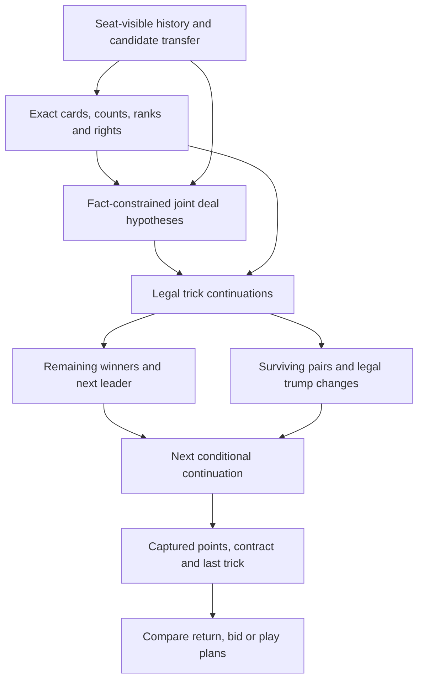

# Live planning audit: connected suit control

Base: `1bfd8a5`. This is development evidence, not a claim that the human moves
are optimal or that the AI now plays more strongly.

## Evidence

Private dataset SHA-256:
`e41a69d6f81819dc3619655c9a35ca39c906a8ebe647e3aac869bd65b8823865`.
Only the three owner-selected players were evaluated. Of 496 matching games,
494 replayed completely; two historical illegal card plays were excluded.
The agent received only the acting seat's view, and each comparison continued
with the actual recorded human action. Decisions from the same game are not
independent observations. These records are development data, not a holdout.

- Auction: 922 decisions, 564 exact agreements. The AI passed on 174 human bids;
  humans passed on 36 AI bids. Above or at a current value of 140, the AI passed
  on all 379 examined decisions. Ordinary strong-hand continuation is absent;
  this is not merely a low threshold. The take-140 weights predict human choice,
  not the probability of fulfilling a contract. Post-exchange raising is disabled.
- First exchange: 115 decisions, 60 exact agreements. The AI retained fewer voids
  in none of them, the same number in 103, and more in 12. More voids are not
  necessarily better: the useful entry, trump and retained suit matter.
- Returns: 155 complete replays, 22 exact agreements. Humans retained 181 voids
  in total and returned 76 Aces; the baseline AI retained 204 voids and returned
  81 Aces. So a general claim that it rarely returns Aces is not supported.
- In 22 of these returns the AI gave a King, Ober, Unter or Ten beneath a kept
  Ace that the human retained. This identifies review candidates, not 22 errors.
  Some are useful partner entries or pair transfers. One long-suit example
  exposed a real shortlist gap: the existing forecast preferred the human return
  when explicitly offered, but candidate generation had excluded it.
- In the earlier random ten-declarer sample, seven human returns were absent from
  the shortlist. Adding the human option changed the forecast preference once.
  Candidate coverage therefore explains only part of the disagreement.

The reproducible private replay driver reuses `tools::legacy::replay`, the current
agent, and the original sampler and continuation policy. It does not read the
opponents' actual hands into the AI. Raw records, player identifiers, selected
record indices and diagnostic traces remain outside Git.

## General concepts and dependencies

**Developing suit control** is a conditional route, not a bonus for a long suit.

1. **Allocation and rank blockers:** what each return leaves in our hand, which
   cards are known with partner, and which higher ranks remain outside our control.
   Existing owners: card sets, `knowledge`, and the actual transfer transition.
2. **Opponent and partner suit lengths:** who must follow a planned round, who
   may be void, and which blockers could survive. These must be joint hypotheses
   consistent with all hands, bidding, visible transfers and played cards.
   Existing owner: `Mind` and its fact-constrained deal weights. A plausible
   blocker falling is not a fact that it has fallen.
3. **Legal trick continuation:** forced Ace play, following, overtaking, ruffing
   and overruffing consume particular cards and determine the next leader.
   Existing owners: engine transitions and the Game Solver's trick-control query.
4. **Promoted winners and entries:** after that continuation, reassess remaining
   ranks and who can reach them. A team winner is not necessarily our own lead.
   Do not add independently possible tricks that require incompatible sequences.
5. **Surviving pair and trump opportunities:** the required halves must remain,
   the right player must have a legal opportunity, and only an unannounced suit
   may become trump. A trump change can invalidate a previously safe side run.
   Existing owners: `Reach`, legal transitions, and the joint entry query.
6. **Contract and series consequences:** score complete conditional routes with
   the engine's scoring. A pair held is not a pair scored, and hand points are
   not captured points. Bidding/raising need this estimate, not imitation weights
   relabelled as success probabilities. Series strategy is still separate work.

This describes dependencies between existing typed owners, not a new runtime
Bayesian-network framework. Exact facts stay in `knowledge`; uncertain evidence
stays in `beliefs`; search and policy consume both. Hypothetical transfers must
update those dependencies before evaluation. Existing history/parameter checking
and decision-local route caches own invalidation; partners cannot share private
plans or hidden hands.

## What this iteration fixes, and what remains

Return candidate generation now represents each feasible retained suit length,
each held-half allocation and each suit's legal returned-Ace entry. C42 still
orders representatives; the existing seat-local rollout compares their outcomes.
No weights, suit-specific preferences or recorded-hand exceptions were added.
This prevents a long developing suit being excluded just because a short return
has a better static score. It does not guarantee every useful rank allocation is
included or that the continuation policy chooses the best follow-through.

The baseline's `standing_after` counts the rank run already standing in the kept
hand. Its `future_win` approximation is used later in card play; it is not a
joint proof of promotion after successive rounds. The general suit-control
concept above is **not fully implemented by broadening the shortlist**.

Before extending selection further, expose and validate those conditional routes
against legal traces: blocked Ten falling versus surviving; partner overtaking;
short suit exhausting; later ruff; counter-trump; a consumed half; and a useful
returned entry compared with keeping the winner. Then reuse that result across
returning, bidding and card play. Do not add another fitted sum with redefined
features or a rule saying to keep every card below an Ace.

Other unresolved dependencies: pass-choice intent is not inferred; positive
probability of a split pair currently reserves an entire suit; ordinary auction
continuation above 140 and raising still lack a game-value model. These findings
must not be described as fixed by the allocation change.

## Shared continuation evidence

`heuristic::planning` now owns the existing policy rollout and outcome aggregation;
return selection calls it. Each forecast credits the actual winning card of each
completed trick. A developed winner had higher ranks outside its initial hand,
all of which fell in earlier tricks of that same continuation. A card below an
Ace is counted as a developed winner only if it actually wins in the forecast.

The return explanation separates wins and developed wins from kept cards and
returned cards. These are weighted conditional outcomes under the current policy,
not independent bonuses, guaranteed winners or calibrated probabilities of optimal
play. They do not change selection: engine scores still compare complete routes.
An interrupted comparison publishes none of these partial outcome estimates.

This is the first shared planning implementation slice. The card-play policy still
uses its earlier `future_win` approximation and pair protection; bidding has not
been connected. The dependency map above remains the intended complete structure.
See the [continuation checkpoint](../checkpoints/2026-10-09-coherent-forecasts.md).

For future pass interpretation, the same ideas must be evaluated from the
hypothetical giver's information. Observing its choice can then update the
likelihood of those hands; it cannot turn a plausible intention into a fact or
reuse the recipient's private knowledge as though the giver had seen it.
