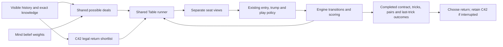

# Bounded return forecasts

Continuation authorised 2026-10-09: finish the coordinated v1 slice, then live-test.

The existing play policy supplies the continuation. Compare legal returns on the
same sampled deals and play each to completion through the engine. Each simulated
seat receives only its own observation stream. Never optimise future actions by
looking at the sampled opponents' hands. Engine outcomes count distinct tricks,
actual pair activations, changed trumps and the last-trick bonus exactly once.
The forecast is conditional on these policies and approximate belief weights;
it is not a calibrated chance of optimal play.

Reuse the existing table runner by moving its observation/seat-view machinery
from `eval` to `agent`. Evaluation continues to re-export it. This avoids either
copying privacy logic or making production decisions depend on evaluation.
That relocation is a separate behaviour-preserving checkpoint.

Reconstruct a hypothetical original deal by reversing the observed first pass
from a fact-consistent pre-return deal. Replay the public auction and visible
exchange through that table. All candidates share that history and the partner's
same five unknown cards. Only the proposed four-card return changes.

Cheap C42 features remain a candidate ordering, with unchanged feature meanings.
Selection and shortlisting share one scored option list; each legal return is
scored once. The chosen explanation is derived by the same C42 owner.
The bounded shortlist includes the four leading returns, distinct retained,
transferred and split-pair allocations, and a legal opening toward a returned
ace. Complete the same worlds for every
candidate before comparing them. Score using actual engine contract outcomes;
retain the existing choice when the comparison cannot finish within its budget.
No fitted coefficients are repurposed as score probabilities.

Live continuation reuses the same existing entry, announcement and play owners;
it observes actual events and recomputes from them. No hidden shared team plan,
fixed nine-trick script or independent graph/cache is introduced. Raising stays
disabled. Exact rollout budgets and qualification evidence must be recorded
before enabling the return choice; budget exhaustion must be visible.

Initial development comparison: eight shared deals, best C42 return for each
possible held-pair allocation. Review then added the four leading C42 returns
and a legal opening toward a returned ace, so hands without pairs also receive
alternatives. The final shortlist has at most eighteen candidates (including a
possibly sampled baseline choice). Use a two-second return deadline; unfinished
comparisons keep C42. Rollout play uses
the existing policy with its solver restricted to two cards/eight worlds. Live
play retains four cards/64 worlds. Rank completed candidates by mean engine game
score difference; ties retain C42. No new strategic weights. Report these as
policy forecasts, not calibrated probabilities. Inspect broader candidate sets
offline before claiming the shortlist finds the best possible return.

Development: 32 duplicate deals in `dev`; validation: 64 in `check`, with seat
rotation. Qualification after freezing: 128 deals in fresh `seed202610091`,
with seat rotation, compared with `return_worlds = 0`. Record the full fixed run,
score interval, failures and timing; do not stop early or tune on qualification.
Human traces already used for development cannot qualify this version.

Acceptance: legal replay, correct nine-card allocations, own-view privacy,
surviving/consumed halves, forced ace/green opening, entries interrupted by
opponents, trump changes, last-trick scoring, fresh/reused agreement. Use the
already reviewed human examples as development evidence, never a holdout. Freeze
parameters before the fixed-size duplicate qualification; report agreement and
playing strength separately. Measure return latency separately from the 50 ms
small-endgame target. No v1 completion claim without those results.

Debug outputs use `forecast_*`, separate from C42's signed `plan_*` score
contributions. `forecast_target` is the contract known before the return, not a
later human raise. `forecast_made` and `forecast_last` are weighted sample shares;
`forecast_shortfall` averages the positive point deficit over all sampled worlds,
including zero for successes. The effective sample size is shown. None is a
calibrated probability. Deadline checks are cooperative, not hard real-time bounds.

The loop spends each played card once. A later ruff therefore uses the remaining
cards and current trump, and an announcement needs the surviving halves, the
right leader and that player's current rights. These are engine transitions,
not independent bonuses added to an abstract hand score. The live policy reads
the actual new observations after the return; it does not blindly follow a
simulated hidden deal. The four-card Game Solver remains a bounded PIMC aid.

Implementation, fixed qualification, resource limits and known timing caveats are
recorded in the [return-planning checkpoint](../checkpoints/2026-10-09-return-planning.md).
